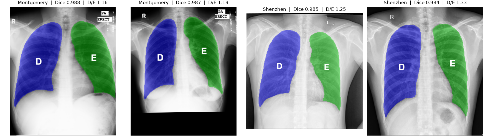
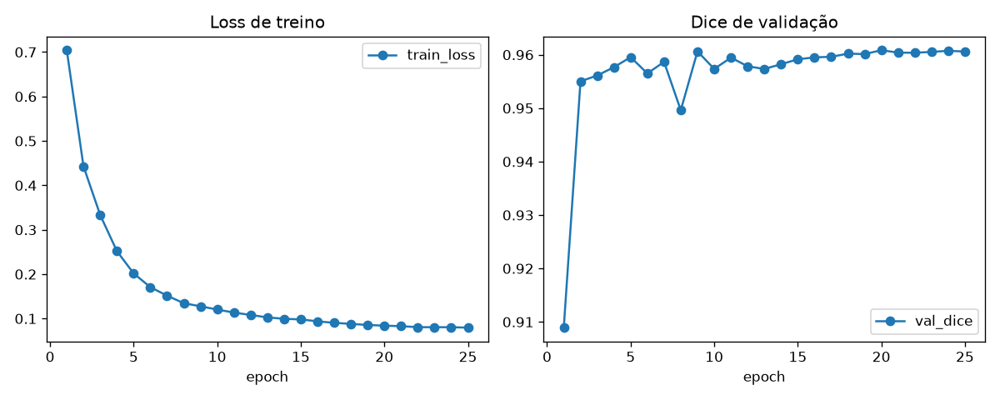

# lung-seg-cxr

Lung segmentation on chest X-rays with a U-Net (ResNet34 encoder pretrained on ImageNet), split into right and left lung, and the ratio between their areas (R/L).



> **Educational project. It is not a medical device and must not be used for diagnosis or any clinical decision.**

## Setup (Apple Silicon Mac)

```bash
python3 -m venv .venv
source .venv/bin/activate
pip install -e ".[dev]"
```

It also runs on CUDA and CPU with no changes: the device is picked automatically (cuda > mps > cpu).

The dataset comes from Kaggle (`nikhilpandey360/chest-xray-masks-and-labels`). If the download asks for authentication, save the token from https://www.kaggle.com/settings to `~/.kaggle/kaggle.json` or export `KAGGLE_USERNAME` and `KAGGLE_KEY`. You can also download it manually and run `lungseg prepare --raw-dir FOLDER`.

## Commands

| Command | What it does | Outputs |
|---|---|---|
| `lungseg prepare` | downloads the dataset, pairs images with masks, builds the cache and the split | `data/cache_256.npz`, `outputs/split.json` |
| `lungseg train` | trains and saves the best checkpoint (by validation Dice) | `outputs/best.pt`, `outputs/train_log.csv`, `outputs/curves.png` |
| `lungseg evaluate` | raw and post-processed Dice, R/L ratio error | `outputs/eval.csv`, `outputs/ratio_scatter.png`, `outputs/best_worst.png` |
| `lungseg explore` | R/L ratio on the annotated masks by source and TB label | `outputs/explore.csv`, `outputs/ratio_boxplot.png` |
| `lungseg predict IMG [--out PATH]` | segments one image and prints the areas and the ratio | overlay PNG |
| `lungseg app [--share]` | Gradio demo at http://localhost:7860 | |

Any key in `configs/default.yaml` can be overridden from the CLI, for example `lungseg train --epochs 1 --batch-size 8`. Tests: `pytest`.

## Radiological convention

On a frontal (PA) X-ray the patient faces the viewer. So **the lung on the left side of the image is the patient's right lung**. Right and left always refer to the patient. The overlays and the program output use the Portuguese initials: **D** (*direito*) = right, in blue, and **E** (*esquerdo*) = left, in green.

For the same reason, training **does not use horizontal flips** as data augmentation: mirroring the image would swap the anatomy's sides.

Post-processing keeps the two largest connected regions of the predicted mask and orders them by the horizontal position of their centroid.

## Results

| Metric (validation) | Value |
|---|---|
| Dice (raw) | 0.961 |
| Dice (post-processed) | 0.961 |
| Mean absolute R/L ratio error | 0.074 |

U-Net with a ResNet34 encoder, 25 epochs on an Apple Silicon Mac (MPS), about 30 seconds per epoch (~13 minutes total); best checkpoint at epoch 20. 106 validation images.



### Architecture comparison

Same encoder (ResNet34, ImageNet), same split, same seed and 25 epochs for all of them.

| Architecture | Parameters | Mean Dice | Median Dice | Worst Dice | Mean R/L ratio error | Best epoch | Training time |
|---|---|---|---|---|---|---|---|
| U-Net | 24.4 M | 0.961 | 0.971 | 0.822 | 0.074 | 20 | ~13 min |
| U-Net++ | 26.1 M | 0.962 | 0.972 | 0.815 | 0.076 | 15 | ~21 min |
| UNet 3+ | 27.8 M | 0.962 | 0.972 | 0.798 | 0.075 | 17 | ~48 min |

All three are within 0.001 Dice of each other. With a single seed and 106 validation images, that difference is within the noise: in practice they tie. UNet 3+ takes almost 4 times as long as U-Net and has the weakest worst case, so U-Net stays the default because it is the fastest.

UNet 3+ is not in `segmentation_models_pytorch`; the implementation is in `src/lungseg/model.py` (class `UNet3Plus`), with the same ResNet34 encoder and without the deep supervision or the classification-guided module of the original paper (Huang et al., 2020). Use `--arch unet3plus`.

To train another architecture without overwriting the current one:

```bash
lungseg train --arch unetplusplus --outputs-dir outputs/unetplusplus
lungseg evaluate --arch unetplusplus --outputs-dir outputs/unetplusplus
```

Copy `outputs/split.json` to the new folder first, so it is evaluated on the same validation set.

Figures in `outputs/`: `curves.png`, `ratio_scatter.png`, `best_worst.png`, `ratio_boxplot.png`.

The exploratory analysis (`lungseg explore`) compares the R/L ratio between normal and tuberculosis exams. Source, hospital, scanner and population are confounded with the label, so the differences do not support clinical conclusions.

## Data credits

- **Montgomery County X-ray Set** and **Shenzhen Hospital X-ray Set**: National Library of Medicine (NLM/NIH). Jaeger S. et al., "Two public chest X-ray datasets for computer-aided screening of pulmonary diseases", *Quant Imaging Med Surg* 2014;4(6):475-477.
- Masks and organization on Kaggle: `nikhilpandey360/chest-xray-masks-and-labels`.
